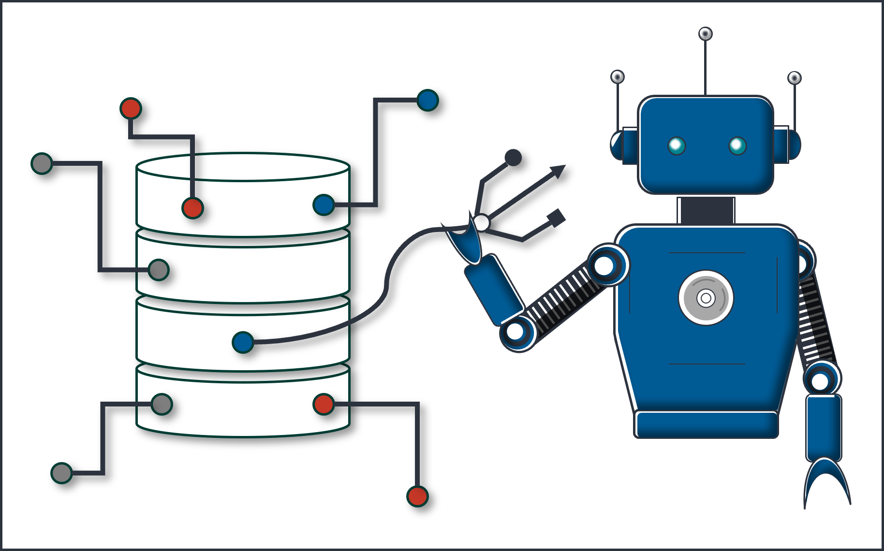
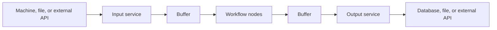

# PyDataAgents



**Your data. Your workflows. Your way.**

**Build continuous data processing and automation workflows?with or without AI, with or without a UI, on your own machine or a company server.** PyDataAgents gives you the flexibility to assemble the application you need: connect industrial equipment and business systems, transform incoming data, and trigger actions through reusable Python components.

Start with a local automation script, keep a data pipeline running in the background, or add an interactive interface and REST API. Combine buffers, services, and workflow nodes to control how data moves, when processing happens, and which actions follow. Add AI for tasks that benefit from it, and run the application in the environment that fits your needs.

A **Data Agent** is the application you build from these components. It can monitor signals, transfer data, process documents, or coordinate conditional workflows. PyDataAgents is an Industrial Internet of Things (IIoT) framework at its core, with building blocks for broader data processing and automation.

**Experimental, with testing in place.** The project targets Python **3.11+** and remains experimental at its current stage. The repository includes unit tests and regression scenarios; the local quickstart and YAML/API setup below have been verified. Integration coverage and requirements vary by component, operating system, and external system.

[Get started](#quickstart) · [Architecture](#how-it-works) · [Integrations](#integrations-and-optional-dependencies) · [Documentation](#documentation-and-examples) · [Contributing](Contribute.md)

## Why PyDataAgents?

- **Compose around data:** reuse buffers to connect acquisition, transformation, and output components without putting all logic in one script.
- **Connect industrial and business systems:** implementations cover protocols such as OPC UA, ADS, S7, and MQTT alongside files, databases, HTTP, and Microsoft Graph.
- **Choose how work runs:** execute a sequence once, schedule repeated processing, or build a graph with actions and transitions.
- **Add application interfaces:** wrap an agent with a FastAPI REST API and a NiceGUI interface for inspecting and managing its components.
- **Extend the same component model:** implement a connector, processing node, or reusable service using the framework's base classes and dataclass configuration.
- **Add AI where useful:** combine model calls, retrieval, file context, or a separately installed coding-agent CLI with buffer-based workflows.

Typical applications include collecting controller values for storage, preparing sensor data for visualization, and extracting document content for subsequent processing. These are applications you assemble from components; endpoints, business rules, and deployment configuration remain specific to your system.

## Contents

- [Installation](#installation)
- [Quickstart](#quickstart)
- [How it works](#how-it-works)
- [Configuration and application interfaces](#configuration-and-application-interfaces)
- [Integrations and optional dependencies](#integrations-and-optional-dependencies)
- [Extending the framework](#extending-the-framework)
- [Documentation and examples](#documentation-and-examples)
- [Development and support](#development-and-support)
- [License](#license)

## Installation

The repository is named **PyDataAgents**; its Python distribution and import package are named **`pydag`**. Start with a local checkout:

```bash
git clone https://github.com/PyDataAgents/PyDataAgents.git
cd PyDataAgents
```

Choose either a Python virtual environment or a Conda environment.

### Python virtual environment

```bash
python -m venv .venv
```

Activate the environment using the command for your shell:

```powershell
# Windows PowerShell
.\.venv\Scripts\Activate.ps1
```

```bash
# Linux / macOS (bash or zsh)
source .venv/bin/activate
```

Then install the base package:

```bash
python -m pip install .
```

### Conda environment

If you use Anaconda or Miniconda, run these commands from the checkout in a terminal with Conda initialized (for example, Anaconda Prompt on Windows):

```bash
conda create -n pydataagents python=3.11 pip
conda activate pydataagents
python -m pip install .
```

Create the environment with both Python and pip so installation uses the intended environment. Reactivate it with `conda activate pydataagents` in each new terminal before running your application. Use this environment directly; there is no need to create the `.venv` above as well.

### Optional components

The base installation is sufficient for the quickstart below. Install extras only for the components you plan to use. For example, from the checkout:

```bash
python -m pip install ".[iiot]"
# Or combine industrial connectors and the application UI:
python -m pip install ".[iiot,ui]"
```

See [integrations and optional dependencies](#integrations-and-optional-dependencies) before installing extras. Python packages do not supply every required driver, executable, credential, or external service. Environment setup commands above do not imply that every integration supports every operating system.

## Quickstart

Run a local workflow that reads three temperature samples from a buffer and logs them once. It requires no hardware, network connection, credentials, or optional extras.

Save this as `quickstart.py`:

```python
from pydag.agents.Agent import Agent
from pydag.buffers.DictBuffer import DictBuffer
from pydag.nodes.buffers.LinkBufferAction import LinkBufferAction
from pydag.nodes.utils.PrintBufferAction import PrintBufferAction
from pydag.services.statemachine.SimpleStatemachine import SimpleStatemachine
from pydag.services.ThreadType import ThreadType

agent = Agent(id="local-demo")
samples = DictBuffer(
    id="samples",
    initial_values={"temperature": [21.5, 22.0, 23.5]},
)
agent.add_buffer(samples)

source = LinkBufferAction(id="source", buffer_id="samples")
show = PrintBufferAction(id="show", input_keys=["temperature"])
source.add_child(show)

workflow = SimpleStatemachine(
    id="print-once",
    thread_type=ThreadType.ONLY_ONCE.value,
)
workflow.add_node(source)
workflow.add_node(show)
agent.add_service(workflow)

try:
    agent.release(stop_when_idle=True)
finally:
    agent.terminate()
```

Run it in your activated environment:

```bash
python quickstart.py
```

Among the lifecycle log messages, you will see these three records, with log timestamps and prefixes:

```text
{'temperature': 21.5}
{'temperature': 22.0}
{'temperature': 23.5}
```

`release()` installs the registered components and starts the workflow. `LinkBufferAction` exposes the existing buffer to the next node; `PrintBufferAction` reads its parent's temperature column. Nodes are added in execution order because `SimpleStatemachine` executes a flat sequence. The parent-child connection defines where the print node gets its input.

`ONLY_ONCE` runs the sequence once. `stop_when_idle=True` terminates the agent when no registered service reports `RUNNING`, so this example exits on its own. Termination uninstalls buffers and clears their in-memory contents; read or export results before shutdown if you need to retain them.

## How it works

### Components and data flow

An `Agent` owns buffers and services. Workflow services own their nodes and install them as part of the agent lifecycle.



This is a common composition pattern. Choose input and output services for the systems you actually use; workflows can also work entirely on local buffers, as in the quickstart.

| Building block | Responsibility |
| --- | --- |
| [`Agent`](pydag/agents/Agent.py) | Registers components, installs them, starts eligible services, and coordinates termination. |
| [`AgentElement`](pydag/agents/AgentElement.py) | Provides element identity, configuration inspection, installation, and uninstallation hooks. |
| [`Buffer`](pydag/buffers/Buffer.py) | Exchanges and temporarily stores data through a common public interface. |
| [`Service`](pydag/services/Service.py) | Provides a runtime capability, connection, or background task with start/stop behavior. |
| [`ObserverService`](pydag/services/ObserverService.py) | Executes observers using an interval, schedule, trigger, or another supported execution mode. |
| [`MappingService`](pydag/services/MappingService.py) | Connects external addresses and agent buffers for supported transfer operations. |
| [`Action`](pydag/nodes/Action.py) / [`Transition`](pydag/nodes/Transition.py) | Performs a workflow step or evaluates whether execution can advance. |

### Agent lifecycle

Constructing and registering components describes an application. Releasing the agent installs its buffers and services, then starts services whose `auto_start` setting is true. Installation can initialize connections and resources; it is more than configuration validation.

| Call | Behavior |
| --- | --- |
| `agent.release()` | Starts the application and blocks until termination. |
| `agent.release(blocking=False)` | Starts the application and returns control to the caller. |
| `agent.release(stop_when_idle=True)` | Blocks until no registered service reports `RUNNING`, then terminates. |
| `agent.release(blocking=False, stop_when_idle=True)` | Monitors service states and performs idle termination in a background thread. |
| `agent.terminate()` | Stops services, uninstalls components, and releases a waiting `release()` call. |

Use idle termination for finite services such as the quickstart. It checks service states, not whether buffers contain data or every possible background resource has finished. For an ongoing application, use explicit termination and place cleanup in a `finally` block.

### Buffers and data selection

Use `push(...)` to add data, `data(n=0, persistent=True)` to read it, `size()` to inspect its size, and `clear()` to remove its contents. `data_with_meta(...)` adds the buffer's metadata representation.

For list and dictionary buffers, `n=0` retrieves all available samples. `persistent=True` keeps the retrieved values; `persistent=False` consumes them. This controls reads from memory and does **not** enable storage on disk. If multiple consumers share a buffer, decide which may consume its values.

| Buffer family | Useful for |
| --- | --- |
| [`ListBuffer`](pydag/buffers/ListBuffer.py) | A capacity-limited sequence exposed as a dictionary keyed by buffer ID. |
| [`DictBuffer`](pydag/buffers/DictBuffer.py) | Column-oriented records such as `{"temperature": [21.5, 22.0]}`, with optional timestamp and index columns. |
| [`TimedBuffer`](pydag/buffers/TimedBuffer.py) | Values with corresponding timestamps. |
| [`SignalBuffer`](pydag/buffers/SignalBuffer.py) / [`SampledBuffer`](pydag/buffers/SampledBuffer.py) | Periodically sampling configured synthetic signals, one value or a batch at a time. |
| [`DatasetBuffer`](pydag/buffers/DatasetBuffer.py) | Loading supported datasets for processing and experiments; some sources need additional dependencies or downloads. |

List and dictionary buffers discard older values when their configured capacity is exceeded; `capacity=-1` means unlimited capacity. Data shapes and metadata differ between implementations. See the [buffer reference](pydag/_docs/Buffers.md) and the concrete class before connecting components.

### Mappings and execution modes

A mapping connects `buffer_ids` with external `addresses`, such as protocol addresses, database queries, or topics. Address syntax and pairing rules belong to each connector.

`MappingType` defines `READ`, `WRITE`, `SUB`, and `PUB`. A connector implements only a subset: for example, MQTT uses subscription and write behavior, while SQL implements reading and writing. Check the concrete service rather than assuming all four operations are supported.

Important settings include `n` for sample selection, `persistent` for retaining values read for output, and `thread_type` / `observing_time` for execution timing. Observer modes include one-shot execution, intervals, cron expressions, and explicit triggers. Units depend on the selected mode: for example, `SECOND` uses seconds and `MILLI_SECOND` uses milliseconds. These are Python scheduling mechanisms, with no hard real-time guarantee.

### Workflows, tasks, and models

- **`SimpleStatemachine`:** visits active nodes in insertion order. An action executes its task; a false transition stops the current pass. Parent-child links support data relationships but do not turn this executor into a branching graph scheduler.
- **`SFCService`:** executes connected actions and transitions using Sequential Function Chart logic. Use it for graph-based control flow, including supported branching and joins. Register all nodes and connect their children; see the [workflow documentation](pydag/_docs/Nodes.md).
- **`BufferNode`:** links an existing buffer or creates one for intermediate results. It reads parent data using `n`, `persistent`, `input_keys`, and `ignore_keys`; selectors can choose names, positions, slices, or supported value types. `output_keys` names results where the concrete node supports it.
- **`ServiceNode`:** gives a node access to a reusable service, such as a browser or model provider.
- **[`TaskRunnerService`](pydag/services/tasks/TaskRunnerService.py):** combines conventional Python callables and action/buffer-node steps in a configured sequence with input/output mappings. It defaults to triggered execution and `auto_start=False`.
- **[`DataModelService`](pydag/services/datamodel/DataModelService.py):** manages dataclass-based computation models and relationships between model variables, with associated API and UI components.

## Configuration and application interfaces

### Python and YAML composition

Use Python composition as shown in the quickstart, or load an application configuration through `AgentApp.load(...)`. The loader accepts a YAML file path or a configuration dictionary. `AgentApp.save(...)` writes YAML, and `config_options()` exposes configuration values.

Element IDs connect services, buffers, and nodes. Serialized `type` values identify the Python modules used to construct components, for example `pydag.buffers.DictBuffer`. Preserve these identifiers when reusing saved configurations.

The repository includes [application YAML examples](tests/regression/agents/app). A minimal local configuration, saved as `agent.yaml`, is:

```yaml
host: localhost
port: 8081
with_api: true
with_ui: false
agent:
  id: local-agent
  buffer_store:
    readings:
      type: pydag.buffers.DictBuffer
      id: readings
      initial_values:
        temperature: [21.5, 22.0, 23.5]
```

Install `.[ui]` before using `AgentApp`: its module imports NiceGUI even when `with_ui` is false. Save this launcher as `app.py`:

```python
from pydag.agents.app.AgentApp import AgentApp

if __name__ == "__main__":
    app = AgentApp.load("agent.yaml")
    app.create()
    try:
        app.run()
    finally:
        app.shutdown()
```

Run `python app.py` and open `http://localhost:8081/docs` for the API documentation. This server runs until stopped; use Ctrl+C in the terminal. Enable `with_ui: true` to add the default buffer and agent-management pages.

The example binds to localhost and does not configure API authentication. `AgentApp` supports API-key configuration through `api_key_file`; configure authentication and deployment access controls before exposing management endpoints beyond your machine. [`AgentStoreApp`](pydag/agents/app/AgentStoreApp.py) provides a UI for managing an `AgentStore` containing multiple agents.

### Persistence

Application YAML describes composition and configuration. Separately, `AgentElement.save(...)` and `load(...)` use per-element JSON files. Their path argument is a directory prefix concatenated with the element ID and `.json`; supply the appropriate trailing path separator.

`Agent(with_persistence=True)` adds an `AgentPersistService` that periodically saves registered buffers and services marked with `load_on_install=True`. The service creates the save folder, and buffer serialization includes current values as initial values. This is separate from YAML export and from the `persistent` read flag. See the [persistence implementation](pydag/services/utils/AgentPersistService.py) before choosing restart and retention behavior.

## Integrations and optional dependencies

The following are representative implementations, not a guarantee that every external system or operation is supported. Follow the component's configuration and inspect its relevant examples before connecting to a live system.

Extras below are installed from the checkout using `python -m pip install ".[extra]"`; combine them with commas when needed.

| Area | Representative components | Extra / external requirements |
| --- | --- | --- |
| Industrial controllers and messaging | [OPC UA](pydag/services/opcua/OpcUaService.py), [ADS](pydag/services/ads/AdsService.py), [S7](pydag/services/s7/S7Service.py), [MQTT](pydag/services/mqtt/MQTTService.py), [IO-Link](pydag/services/iolink/IOLinkService.py) | `iiot`; reachable servers, brokers, or controllers; protocol-specific drivers and configuration. |
| Socket and serial communication | [TCP, UDP, WebSocket, and serial services](pydag/services/socket) | `iiot` supplies serial and WebSocket dependencies; endpoints or serial hardware as applicable. |
| Databases | [SQLService](pydag/services/db/SQLService.py), [InfluxDbService](pydag/services/db/InfluxDbService.py) | `db`; an ODBC driver and connection string for SQL, or an InfluxDB instance and credentials. |
| Files and documents | [Document services](pydag/services/documents), [CSV services](pydag/services/csv), [document actions](pydag/nodes/documents) | `docs` for document parsing, spreadsheets, templates, and file watching; format-specific prerequisites may apply. |
| Microsoft 365 | [MSGraphService](pydag/services/office/MSGraphService.py), [Outlook actions](pydag/nodes/office) | `office`; application registration, permissions, and authentication for the target tenant. |
| HTTP | [HttpService](pydag/services/http/HttpService.py), [HTTP actions](pydag/nodes/http) | HTTP components use `urllib3` supplied by `iiot`; endpoint-specific authentication and configuration. |
| Browser automation | [BrowserAutomationService](pydag/services/webbrowser/BrowserAutomationService.py), [browser actions](pydag/nodes/webbrowser) | `browser`; a supported installed browser and Selenium driver setup. |
| OCR | [OCRAction](pydag/nodes/vision/OCRAction.py) | `ocr`; Tesseract and Poppler executables (`pdfinfo`, `pdftoppm`) on PATH. |
| Signal processing and features | [FFTTransform](pydag/nodes/preprocessing/frequency/FFTTransform.py), [feature extractors](pydag/nodes/featureextraction), [dimensionality reduction](pydag/nodes/dimreduction) | FFT uses base dependencies; advanced components may require `dsp`, model downloads, and additional component-specific packages. |
| Application UI and visualization | [AgentApp](pydag/agents/app/AgentApp.py), [UI pages](pydag/agents/ui), [PlotlifyAction](pydag/nodes/documents/PlotlifyAction.py) | `ui` for NiceGUI/Plotly; rendering workflow graphs additionally requires the Graphviz `dot` executable on PATH. |
| Language models and retrieval | [LLMService](pydag/services/llm/LLMService.py), [RAGService](pydag/services/llm/RAGService.py), [LLMChatAction](pydag/nodes/llm/LLMChatAction.py) | `llm`; provider credentials or a local model server, and embedding/model resources as applicable. |
| Coding-agent execution | [AgentHarnessAction](pydag/nodes/llm/AgentHarnessAction.py) | Separately installed and authenticated Codex CLI on PATH, plus an accessible working directory. |
| SFTP transfers | [SFTPAction](pydag/nodes/sftp/SFTPAction.py) | `sftp`; an SSH/SFTP server and authentication. |

LLM functionality includes configurable providers, message history, file context, and optional internet context. Provider support varies by operation: inspect `LLMService` for file handling and provider constraints. Internet context requires a Tavily key. `AgentHarnessAction` invokes the external CLI under the account running the agent; configure its working directory and permissions accordingly.

Additional `cad` and `sim` dependency groups support specialized engineering work; inspect the relevant implementation and platform requirements before installing them. Optional extras are dependency bundles, not feature-certification or compatibility guarantees. See [pyproject.toml](pyproject.toml) for exact dependencies.

## Extending the framework

Choose the base class that matches the component's responsibility:

- A `Buffer` for a new storage or data representation.
- A `Service`, `ObserverService`, or mapping base for connections, reusable resources, and background work.
- An `Action` or `Transition` for a workflow step; combine with `BufferNode` or `ServiceNode` when it needs data or a shared service.

Follow nearby dataclass patterns: configuration belongs in fields with useful metadata, while connections and other runtime objects belong in private instance attributes. Call `super().__post_init__()` when overriding initialization and preserve superclass lifecycle hooks. Start services without blocking the caller; stop background work and release resources during shutdown or uninstallation.

Use public buffer APIs for data exchange. Add focused tests and documentation for new behavior, and preserve public IDs and type paths used in saved configurations. The [repository guidance](AGENTS.md) and [contribution guide](Contribute.md) describe these conventions in more detail.

## Documentation and examples

| Resource | Start here for |
| --- | --- |
| [Agents](pydag/_docs/Agents.md) | Agent composition and application classes. |
| [Buffers](pydag/_docs/Buffers.md) | Storage types, signals, and buffer configuration. |
| [Services](pydag/_docs/Services.md) | Connectors, reusable capabilities, and service configuration. |
| [Nodes](pydag/_docs/Nodes.md) | Documented workflow nodes, branching, and data operations. |
| [Agent scenarios](tests/regression/agents) | Examples of complete compositions, including application YAML. |
| [Unit tests](tests/unit) | Focused examples and expected component behavior. |
| [Source](pydag) | Current public signatures and implementation details. |

Some reference pages are generated and may contain incomplete examples. Use the concrete source and relevant tests to confirm arguments. Regression scenarios and even some unit tests require live systems, local files, credentials, downloads, or a GUI; inspect them before running.

## Development and support

For an editable installation with the test dependencies, run from the checkout:

```bash
python -m pip install -e ".[test]"
```

Install only the additional extras needed for your change. Start with relevant tests, for example:

```bash
python -m pytest tests/unit/services/statemachine/test_simple_statemachine.py
```

The full-suite command is:

```bash
python -m pytest
```

Inspect environmental requirements first. The [contribution guide](Contribute.md) requires all tests to pass before opening a PR. Develop changes on a dedicated branch, submit a pull request for review, and **never push directly to `develop`**.

For bugs, questions, or feature requests, use [GitHub Issues](https://github.com/PyDataAgents/PyDataAgents/issues). Include the component, Python/OS versions, a minimal reproduction, expected behavior, and relevant logs with credentials removed.

## License

PyDataAgents is available under the [MIT License](LICENSE).
